  <!-- dynamic typing effect 动态打字效果 -->

  

### Hello 👋, here is xiao taixain ~🤓

<table>
<!-- 个人介绍 -->
<tr><td>

<h2>  About Me </h2>

就读于厦门大学人工智能系[MAC](https://mac.xmu.edu.cn/index.htm)实验室

- 👨🏽‍💻 在**腾讯公司**WXG进行大模型算法实习

- 🌱 以后的方向是多模态大模型、**Agent**、强化学习。

- 🛠️ 热爱计算机科学和 IT 互联网 🖥️ 事业，平时自己也做一些人工智能方向的技术研究。

- 🎓 现在忙于实习和科研，这段时间结束会重拾技术，做一些想做的事

- 💩 我的作品 ⏬⏬
  - <a href="https://github.com/xi029?tab=repositories">>>GitHub 项目</a>
  - <a href="https://blog.csdn.net/weixin_47520540?type=blog">>>CSDN 博客</a>
  - <a href="https://www.cnblogs.com/taixian">>>博客园</a>

- ✨ 本科期间参加各种计算机设计类比赛的作品项目和有趣的课程设计 🔜<a href="https://github.com/xi029/xi029">后续会进行开源</a>

- 🤔 我是一个终身学习者，对编程、人工智能、前沿技术充满热情。

&emsp;  🔭   Ctrl+Z不是时光机，人生没有万能接口，但好在每个死循环里都藏着重启的彩蛋：

碳基生命从不死机，顶多偶尔热更新。

  <table>
    <tr><td>
      
      &nbsp;&nbsp;&nbsp;&nbsp;&nbsp;&nbsp;&nbsp;&nbsp;&nbsp;&nbsp;&nbsp;&nbsp;&nbsp;&nbsp;&nbsp;&nbsp;&nbsp;&nbsp;&nbsp;&nbsp;&nbsp;&nbsp;&nbsp;&nbsp;&nbsp;&nbsp;&nbsp;&nbsp;&nbsp;&nbsp;&nbsp;&nbsp;&nbsp;&nbsp;&nbsp;&nbsp;&nbsp;
      
    </td></tr>
  </table>

 <!-- GitHub 奖杯🏆 -->
  

    
  

  
More stats

  

  
    
  

</td></tr>
</table>

